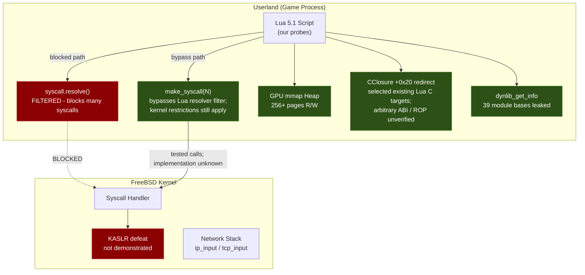
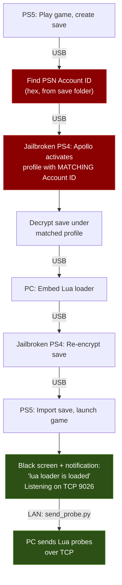

# PS5 Firmware 14.10 - Kernel Research

Open community kernel exploit research on PlayStation 5 firmware **14.10**, conducted via a userland Lua 5.1 loader on TCP 9026.

> **Goal:** Establish a reproducible 14.10 kernel primitive, then assess whether it can support kernel R/W and hypervisor research. None of those kernel-side stages is currently demonstrated.

---

## Funding — Goal Reached!

We've hit our funding goal! Any additional donations go towards hardware and tools to speed up the research.

<a href="https://www.paypal.me/SalwanStudios">

</a>

> **When donating via PayPal, please send as Friends & Family** (not Goods & Services) to avoid payment holds and fees.

### Thank You to Our Donors

These people believed in this research and put their money where their mouth is. It means the world &lt;3

```
Ivan Milinski · Felix Dietz · Brian Alejandro Camacho · Jonathan Moreau · Frank Munsche · Mohammed Kazi · Ismael Jesus · Cassidy Poynter · Mohammad Islam · Flix Rely · Paul E Fox · K Lam · Sean Verkempinck
```

---

## What's New (October 2026)

**Phase 15 — Native Sysent Survey (677–734):** The ELF64 sysent table has 735 entries. We've only surveyed up to 676. **58 native-only syscalls remain completely untested**, including `virtual_query_by_pid` (728, potential KASLR via cross-process VM query) and `mmap2` (725, potential W^X bypass via alternate mapping path). Probes 57a/57b are written and queued.

**Phase 14 results (54a–56l):**
- **CClosure +0x20 redirect confirmed** — Selected existing Lua C functions (rawequal→rawget, rawget→type) produced target-like outputs with successful restoration (probes 56c/56f). This is the strongest userland code execution primitive we have.
- **Exhaustive KASLR survey** — Every accessible information-leak path tested negative. AF_ROUTE sanitized (53b), RDMSR blocked (54k), kldstat lethal (56k4), timing/signal oracles defeated by SMAP (56j/56k2). 17 KASLR techniques tested, zero kernel pointers found.
- **AIO confirmed lethal** — sys 661 instantly kills the process (54c/54f), resolving the earlier inconclusive status.
- **Full process VM map** — sys 674 returns 317 named regions with protections (55e/55f). All userland VA.
- **Sony syscall deep survey** — 30+ Sony-specific syscalls tested. sys 622 (device control, 400+ commands), sys 601 (process control), sys 643 (chicken switches), sys 548 (batch VM), sys 672-676 all dead or useless.
- **sys 624 = VM operation counter** — +5 per mmap, zero jitter, monotonic. Useful as a kernel-operation side channel (52b).

**Next frontier:** Native sysent 677–734 and CClosure→eboot gadget ROP chain.

---

## WebKit Source-Level Vulnerability Research (WK-1200)

Independent source analysis and device testing of WebKit-1200 (the PS5 14.10 WebView engine). All bugs found through manual source auditing of the WebKit-1200 tree against the PS5's specific build configuration (LLInt-only, no JIT, Gigacage disabled, FreeBSD/libpas).

| # | Bug | Severity | Status | Finding |
|---|-----|----------|--------|---------|
| 1 | **CVE-2026-64784 — MetadataTable integer overflow** | Critical | **ALIVE** | [F83](docs/FINDINGS.md#finding-83) |
| 2 | structuredCloneForStream RAB IDL bypass | High | Blocked (mmap zero-fill) | [F84](docs/FINDINGS.md#finding-84) |
| 3 | RAB byteLength inversion | Medium | Blocked (downstream guards) | [F85](docs/FINDINGS.md#finding-85) |
| 4 | RAB TOCTOU race | Medium | Blocked (per-element bounds) | [F86](docs/FINDINGS.md#finding-86) |
| 5 | ClonedArgs butterfly UAF | High | Blocked (conservative GC) | [F87](docs/FINDINGS.md#finding-87) |
| 6 | Auxiliary cell non-tracing | Medium | Real — enables type confusion | [F88](docs/FINDINGS.md#finding-88) |
| 7 | CSSFontFaceSet iterator UAF | High | Not triggerable (event absent) | [F89](docs/FINDINGS.md#finding-89) |
| 8 | Font loca OOB read | Medium | Mitigated (renderer validates) | [F90](docs/FINDINGS.md#finding-90) |
| 9 | BYOB stream prototype poison | Medium | API absent on target | [F91](docs/FINDINGS.md#finding-91) |
| 10 | Stream Tee OOB via RAB resize | Medium | Blocked (bounds + IDL) | [F92](docs/FINDINGS.md#finding-92) |

**CVE-2026-64784** is the primary exploit path. Device-confirmed corruption: JSString `.length=81700`, all characters `'A'`, metadata-only corruption in 14/14 runs. Exploitation in progress — requires reading sweep data from the corrupted JSString metadata path.

### 14.10 WebView API Availability (device confirmed)

**Available:** `structuredClone`, `MessageChannel`, `Canvas 2D`, `SVG`, `Custom Elements`, `Shadow DOM`, `MutationObserver`, `Workers` (Blob URL), `FontFace`, `WebSocket`, `SubtleCrypto`, `Proxy`, `eval`, `BigInt`, `ResizableArrayBuffer`, `WeakRef`, `FinalizationRegistry`, `Streams API` (partial)

**NOT available:** `WASM`, `SharedArrayBuffer`, `WebGL`, `Web Audio`, `IndexedDB`, `XSLT`, `ServiceWorker`, `ReadableByteStreamController`

---

## LAN Research & Network Surface

Independent network research on PS5 firmware 14.10, including full port audits, service identification, and LAN infrastructure tools.

### Network Findings

| Finding | Details |
|---------|---------|
| **Port 41800 = Spotify Connect ZeroConf** | 5-phase identification — not in any published PS5 port map prior to this research ([F93](docs/FINDINGS.md#finding-93)) |
| **Full 65535-port audit** | Only 9295/tcp (Remote Play) and 41800/tcp (Spotify) open on stock 14.10 ([F94](docs/FINDINGS.md#finding-94)) |
| **PUP/SLB2 container parse** | Full structural analysis of PS5 firmware update format ([F96](docs/FINDINGS.md#finding-96)) |

### LAN Research Tools

| Tool | Purpose |
|------|---------|
| `tools/probe41800.py` | Phase 1 HTTP verb/path probe on port 41800 |
| `tools/probe41800_spotify.py` | Spotify Connect ZeroConf protocol probe |
| `tools/probe41800_phase2.py` | Protocol fingerprinting (TLS, binary, mDNS, WebSocket) |
| `tools/probe41800_phase3.py` | HTTP variant probing (keep-alive, no-Host, paths) |
| `tools/probe41800_phase4.py` | Method/format enumeration |
| `tools/probe41800_phase5.py` | Command brute-force (96 protocol words) |
| `tools/dns_serve.py` | DNS interceptor with EDNS/TC/TCP support |
| `tools/dhcp_serve.py` | RFC 2131 DHCP responder |
| `tools/chaos_dns.py` | 7-variant malformed DNS response battery |
| `tools/ps5_recon.sh` | 505-line LAN enumeration (nmap/arp/DDP) |
| `tools/hid_navigate.py` | USB HID keyboard emulation for headless PS5 navigation |
| `tools/hid_send_kb.py` | Standalone HID sender with inline sequence |

All tools use `argparse` with `--ps5-ip` (required) and stdlib-only Python.

---

**Contributors welcome.** Whether you have the hardware or just want to analyze FreeBSD kernel code - there's work to do. See [CONTRIBUTING.md](CONTRIBUTING.md) to get involved.

<!-- RESEARCH_PROGRESS:START -->
## Research progress

[](docs/PROGRESS_AUDIT.md)

**30/100 (~30%) on a subjective, evidence-weighted milestone rubric.** This is not a measured percentage of unknown exploit work, time remaining, or probability of success. **Kernel read/write on 14.10 is not demonstrated.** Hypervisor bypass is excluded from this score.

| Milestone | Points earned / weight |
|---|---:|
| 14.10 research environment | 10/10 |
| Probe tooling and captured evidence | 10/10 |
| Target characterization | 10/15 |
| Validated 14.10 kernel vulnerability | 0/20 |
| Demonstrated 14.10 kernel read/write | 0/25 |
| Repeatable complete kernel exploit | 0/20 |

Audited 2026-10-18. [Evidence and counting rules](docs/PROGRESS_AUDIT.md) · [Machine-readable rubric](docs/progress.json) · [Website](https://marwanmohamed.ca/researchps5#research-progress)

**Update 2026-10-18:** Target characterization raised from 5 to 10/15. Phase 14 (probes 54a-56k5) completed an exhaustive Sony syscall survey, confirmed CClosure +0x20 as a controlled dispatch primitive, mapped the full 317-region process VM, tested the documented KASLR candidates without establishing a kernel base, and analyzed 13.60 kernel dumps. The "complete scoped survey" gate is now earned. The "target-build kernel candidate" gate remains unearned (no 14.10 kernel image available).
<!-- RESEARCH_PROGRESS:END -->

## Current Status: KASLR Wall

**At this time, I am unable to find a v14.10 kernel exploit.** The saved tests have not established a kernel base through the examined paths. Negative or incomplete results do not establish that every information leak is patched or every KASLR technique is impossible. The confirmed userland primitives (CClosure redirect, heap R/W, syscall invocation) are powerful but cannot reach the kernel without knowing where it is.

### Recorded outcomes for tested KASLR candidates

| KASLR Technique | Result | Probe |
|----------------|--------|-------|
| AF_ROUTE kernel pointer leak (Relapse) | Sanitized — zero kernel pointers | 53b |
| mincore/msync/madvise oracle | Lethal — instantly kills process | 56k |
| Timing side-channel via CClosure redirect | SMAP — no differentiation between mapped/unmapped | 56j |
| Signal handler fault recovery oracle | Handler bypasses pcall, no in-process oracle | 56k2, 56k3 |
| RDMSR (sys 626, 567) | Returns -1 for all MSR indices | 54k |
| kldstat/kldnext (sys 307, 308) | Lethal — instantly kills process | 56k4, 56k5 |
| mod* syscalls (sys 300-302) | All return -1 | 56k5 |
| kldsym (sys 337) | Never reached (kldnext kills first) | 56k4 |
| sysctl kernel pointer scan | All values are sentinels, not pointers | multiple |
| sys 674 VM map (317 regions) | All userland VA, zero kernel pointers | 55e, 55f |
| sys 649 module members | Userland addresses only | 54k |
| kinfo_proc full dump | Only sentinels (0xFFFFFFFF_*) | multiple |
| net.route.iflistl scan | sockaddr/MAC structures, no kernel pointers | 54f |
| sys 593 deep struct scan | NID hashes, not kernel pointers | 54f |
| sys 639/638 memory region | Returns -1 for all address ranges | 54f |
| sys 588 (13.60 exploit path) | No-op on 14.10 | 54d |
| AIO (sys 661-670, 13.60 exploit path) | Lethal — sys 661 instantly kills process | 54c, 54f |

### What IS working (strong userland primitives)

| Primitive | Status | Probe |
|-----------|--------|-------|
| CClosure +0x20 redirect | Selected existing Lua C functions returned target-like results and were restored; arbitrary target/ABI support remains unverified | 56c, 56f |
| Heap R/W (256+ pages) | GPU mmap adjacency, no guard pages | 41c |
| Arbitrary syscall invocation | make_syscall(N) for tested numbers | 41w |
| Userland ASLR bypass (39 modules) | dynlib_get_info(593) | 41o |
| Full process VM map (317 regions) | sys 674 with protections and names | 55e |
| Signal handler install | sigaction(416) returns 0 | 56k |
| Network packet injection | RAW socket + IP_HDRINCL | 34-39 |
| sys 624 VM operation counter | +5 per mmap, zero jitter, monotonic | 52b |

The older `fn_addr`/ROP execution interpretation is withdrawn for the tested 45c path. It is distinct from the later CClosure observations. See the [ledger guide](docs/RESEARCH_EVIDENCE.md), [existing evidence audit](docs/EVIDENCE_AUDIT_2026-10-17.md), and [independent audit snapshot](docs/INDEPENDENT_EVIDENCE_AUDIT_2026-10-17.md).

## Exploit Chain Overview

```mermaid
graph LR
    A["Hamidashi Creative<br/>(Artemis Engine)"] -->|modified save file| B["Lua 5.1 Loader<br/>TCP 9026"]
    B -->|memory.* / syscall.*| C["Confirmed userland primitives<br/>CClosure redirect, Heap R/W,<br/>syscall invocation, VM map"]
    C -->|"No validated kernel base in saved tests"| D["KASLR defeat<br/>not demonstrated"]
    D -->|requires KASLR defeat| E["Kernel R/W<br/>not demonstrated"]
    E -->|requires kernel R/W| F["Hypervisor bypass<br/>not demonstrated"]

    style A fill:#2d5016,stroke:#4a8c2a,color:#fff
    style B fill:#2d5016,stroke:#4a8c2a,color:#fff
    style C fill:#2d5016,stroke:#4a8c2a,color:#fff
    style D fill:#8b0000,stroke:#cd5c5c,color:#fff
    style E fill:#8b0000,stroke:#cd5c5c,color:#fff
    style F fill:#8b0000,stroke:#cd5c5c,color:#fff
```



## Architecture



## Key Constraints

- **W^X enforced** - `mmap(RWX)` gives RW only; `mprotect(EXEC)` always fails
- **Execute-only memory (XOM)** - system lib .text is XO (reading crashes); eboot is RX
- **No threading** - `fork`, `rfork`, and `thr_new` were blocked or crashed in tested paths
- **AIO — confirmed hard wall** - sys 661 instantly kills the process on 14.10
- **kldstat/kldnext — confirmed hard wall** - sys 307/308 instantly kill the process
- **Per-connection ASLR** - fresh process per TCP connection
- **SMAP enforced** - no timing differentiation between mapped/unmapped kernel VA
- **No kernel pointers found** - extensive scanning across every accessible interface
- **AF_ROUTE KASLR (Relapse technique) — confirmed dead** - kernel sanitizes route messages
- **RDMSR blocked** - sys 626 and sys 567 return -1 for all MSR indices
- **/dev/dmem0** - GPU aperture only, cannot access CPU/kernel physical memory

## Repository Structure

```
probes/                          # 233+ Lua probe scripts
  phase1_identity_layout/        # 01–08: system ID, syscalls, memory layout
  phase2_kernel_objects/         # 09–21: UMTX, nwake, dmem, AIO, kqueue
  phase3_signals_codexec/        # 22–26: signals, sigaltstack, W^X, XOM
  phase4_ipc_network/            # 27–31: threading, fd passing, socket opts
  phase5_buffer_io/              # 32–33: buffer stress, MSG_DONTWAIT
  phase6_raw_packets/            # 34–39: RAW sockets, fragments, IP options
  phase7_heap_exploitation/      # 40–41: GPU mmap, heap R/W, ROP, ASLR bypass
  phase8_live_network/           # 40tcp, 42: TCP fuzz, ktimer, live testing
  phase9_kaslr_defeat/           # 42b–42j: KASLR attempts, ROP architecture
  phase10_untested_theories/     # 43a–54a: theory-driven probes
  phase13_52batch/               # 52a–52b: Sony syscall survey + 624 oracle
  phase13_53batch/               # 53a–53d: evidence-audit retests
  phase14_final_push/            # 54a–56l: deep syscall survey, CClosure, KASLR
  phase15_native_sysent/         # 57a–57b: native sysent 677–734 (unrun)
results/                         # 700+ raw output captures
tools/                           # send_probe.py, send_probe.ps1, kaslr_bruteforce.py
docs/
  ALL_RESULTS.md                 # Every result file in one document
  ALL_PROBES.md                  # Every probe file in one document
  ATTACK_SURFACE.md              # Complete syscall status map
  FINDINGS.md                    # Detailed technical findings
  PROBE_INDEX.md                 # Every probe with status and key result
  STRATEGY.md                    # Exploit strategy and dead ends
  UNTESTED_THEORIES.md           # Ranked exploit theories
  RESEARCH_PAPER.md              # Full technical research paper
```

## Environment

| Property | Value |
|----------|-------|
| Firmware | 14.10 |
| Kernel | FreeBSD r230171 (Sep 28 2026) |
| Entry point | Lua 5.1 loader on TCP 9026 |
| Page size | 16 KB (0x4000) |
| CPU | Zen 2, 8C/16T (16 logical cores) |
| Securelevel | 1024 (PS5-specific) |

## Quick Start

```bash
# Send a probe (Python)
PYTHONIOENCODING=utf-8 python tools/send_probe.py --save probes/phase14_final_push/56c_redirect_nonvm.lua

# Send a probe (PowerShell, no Python required)
.\tools\send_probe.ps1 probes\phase14_final_push\56c_redirect_nonvm.lua -Save

# KASLR brute force driver (multi-connection)
python tools/kaslr_bruteforce.py --ps5-ip YOUR_PS5_IP --step 0x200000
```

See [tools/README.md](tools/README.md) for details.

## Use AI to Help

All research data is in this repo specifically so anyone can feed it to their AI model of choice. For the best results, use a model with the largest possible context window.

**For maximum-context models (1M+ tokens):**
- Feed `docs/ALL_RESULTS.md` + `docs/ALL_PROBES.md` + `CLAUDE.md` — this is the entire research corpus in three files
- Ask the model to find novel KASLR defeat paths that haven't been tried
- Ask it to cross-reference 13.60 kernel dumps against 14.10 behavior

**For smaller context models:**
1. Start with `README.md` and `CLAUDE.md` for the full picture
2. Feed it `docs/STRATEGY.md` for what's been tried and what's next
3. Feed it `docs/FINDINGS.md` for all technical findings
4. Point it at specific probe results in `results/` for raw data analysis

**What we need help with most:**
- **KASLR evidence** — the examined paths have not established a kernel base. CClosure results support selected existing Lua C targets; extending that to other targets or a kernel disclosure remains a hypothesis.
- **13.60 → 14.10 kernel diff analysis** — the companion repo has 13.60 kernel dumps. Finding what changed between versions could reveal new attack surface.
- **FreeBSD r230171 source analysis** — find exploitable code paths reachable from our ~40 working syscalls
- **Loader internals reverse engineering** — the Lua loader's C-level syscall dispatch may have writable function pointers

The more models looking at this data from different angles, the faster we find a kernel primitive.

## Related V13.60 Research

The companion [PS5 V13.60 Research](https://github.com/ZigZagBoi1/PS5-V13.60-Research) repository maintains the firmware 13.60 Relapse and Byepervisor-Reborn research, its local browser site, and observed stage evidence. This V14.10 project retains `docs/ps5_13.60_sysent.json` for existing strategy and probe tooling; the source copy and attribution are maintained in the companion repository. Relapse's 13.60 support does not imply support on 14.10.

## Userland Entry

The exploit chain uses **Hamidashi Creative** (a Japanese visual novel on the Artemis/Lua engine) as the entry point. A modified save file embeds the Lua loader, which starts a TCP listener on port 9026.



> Red = critical step (Account ID must match or PS5 rejects the save)

- **Game:** Hamidashi Creative (はみだしクリエイティブ) - free demo on Japanese PSN
- **Loader:** Based on [shahrilnet/remote_lua_loader](https://github.com/shahrilnet/remote_lua_loader)
- **Kernel offsets:** From [@hammer-83](https://github.com/hammer-83)'s [ps5-jar-loader](https://github.com/hammer-83/ps5-jar-loader) (fw 1.00–10.01 only - 14.10 offsets TBD)
- **Entry method:** Save file exploit via PS4 backwards compatibility

See [docs/USERLAND_ENTRY.md](docs/USERLAND_ENTRY.md) for the full setup guide, save file chain walkthrough, and supported games list.

## Documentation

| Document | Contents |
|----------|----------|
| [CHANGELOG.md](CHANGELOG.md) | Phase-by-phase progress timeline |
| [CONTRIBUTING.md](CONTRIBUTING.md) | How to contribute to this project |
| [docs/ALL_RESULTS.md](docs/ALL_RESULTS.md) | Every result file in one document (for large-context AI) |
| [docs/ALL_PROBES.md](docs/ALL_PROBES.md) | Every probe file in one document (for large-context AI) |
| [docs/USERLAND_ENTRY.md](docs/USERLAND_ENTRY.md) | Userland exploit setup guide and game details |
| [docs/PROBE_INDEX.md](docs/PROBE_INDEX.md) | Full probe-by-probe breakdown |
| [docs/EVIDENCE_AUDIT_2026-10-17.md](docs/EVIDENCE_AUDIT_2026-10-17.md) | Claim-by-claim evidence review |
| [docs/ATTACK_SURFACE.md](docs/ATTACK_SURFACE.md) | Complete syscall status map |
| [docs/FINDINGS.md](docs/FINDINGS.md) | Detailed technical findings |
| [docs/STRATEGY.md](docs/STRATEGY.md) | Exploit strategy and dead ends |
| [docs/RESEARCH_PAPER.md](docs/RESEARCH_PAPER.md) | Full technical research paper |

## Credits

- Userland loader: [@shahrilnet](https://github.com/shahrilnet) via [remote_lua_loader](https://github.com/shahrilnet/remote_lua_loader)
- Kernel offsets (fw 1.00-10.01): [@hammer-83](https://github.com/hammer-83) via [ps5-jar-loader](https://github.com/hammer-83/ps5-jar-loader)
- PS4 jailbreak: [GoldHEN](https://github.com/GoldHEN/GoldHEN) by [@SiSTRo](https://github.com/SiSTRo) and the GoldHEN team
- Save file management: [Apollo Save Tool](https://github.com/bucanero/apollo-ps4) by [@bucanero](https://github.com/bucanero)
- 13.60 kernel binary dumps and Lua probe loader: [@ZigZagBoi1](https://github.com/ZigZagBoi1) — RE analysis (145/145 handlers) by [@pastawithpesto](https://github.com/pastawithpesto)
- Relapse exploit research (fw 7.00-13.60): AF_ROUTE KASLR defeat technique and AIO race condition methodology
- Artemis engine Lua research: the PS5 homebrew scene
- WebKit-1200 source analysis and CVE-2026-64784: [@pastawithpesto](https://github.com/pastawithpesto)
- LAN research tools and network surface mapping: [@pastawithpesto](https://github.com/pastawithpesto)

## License

This research is for educational and authorized security research purposes only.
